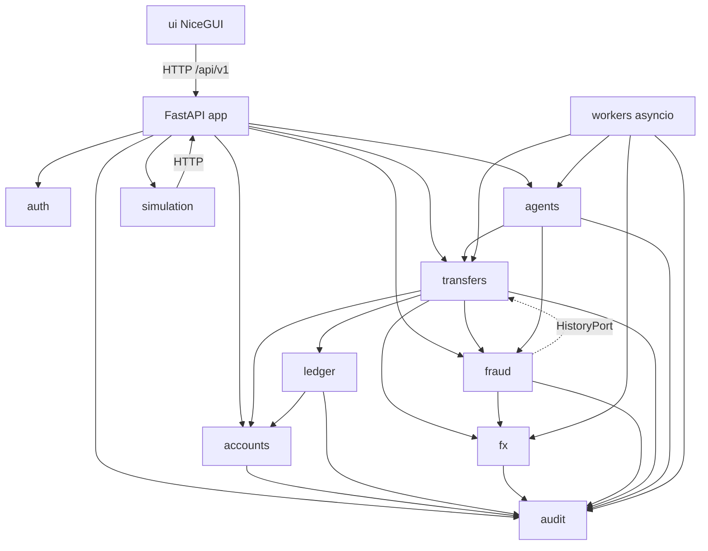

# Arhitectura modulelor

## Straturi

`api` (rute, validare Pydantic) -> `service` (reguli de business, functii pure de domeniu) -> `repository` (SQL explicit).

## Flux de transfer

1. API valideaza cererea si `Idempotency-Key`.
2. O singura tranzactie SQL (`BEGIN IMMEDIATE`): cheie de idempotenta, transfer `created`, cotare FX, evaluare antifrauda, tranzitii de stare, postare in ledger daca decizia este `approve`, raspuns salvat sub cheia de idempotenta.
3. `under_review` deschide un caz in coada de conformitate; agentul recomanda, omul decide.

## Cross-cutting

- `correlation_id`: middleware, apoi `Ctx`, audit, tool-uri de agent, erori.
- `Clock`: injectat in `Ctx`, singura sursa de timp.
- Evenimente (webhook): `audit.service.emit_event`, livrate de worker.
